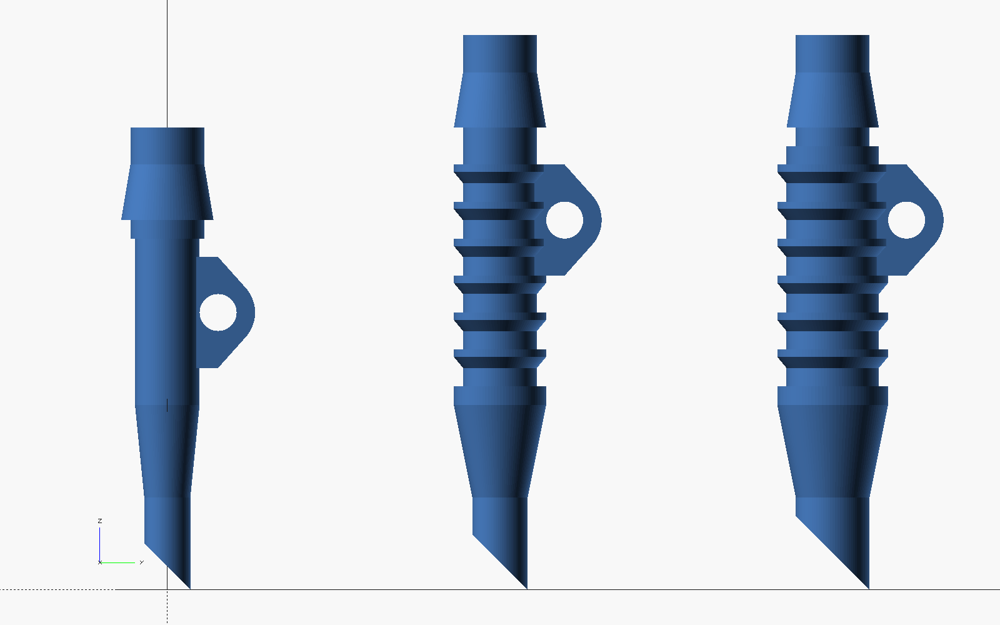

# vhlab-parts

Published parts (descriptions, 3D printing files, board schematics, etc) from VH Lab

# Contents

| Paper | Directory | Description | 
| --- | ---- | --- | 
| Stacy et al. 2021 | `chamber_grid` | Chamber-and-grid system for recordings in lateral geniculate nucleus |
| (in development) | [`trachea_tube`](trachea_tube) | Family of 3D-printable ferret trachea (intubation) tubes: parametric OpenSCAD source, STL files, and a test print plate |

# trachea_tube

A family of 3D-printable trachea tubes for ferrets, designed in
[OpenSCAD](https://openscad.org) (free, open source). One parametric source file
generates every size and variant.



**Design** (all dimensions in mm, measured from the insertion tip):

- Three tip sizes: 2.5, 3.0 and 4.0 mm outer diameter, with a 45° bevel.
- A taper behind the tip widens the tube to the body diameter (3.5, 4.0/5.0 and 5.0/6.0 mm).
- On the 3.0 and 4.0 mm tubes, sawtooth ribs (1 mm rib, 1 mm groove) take a
  suture tie around the trachea for a good seal. Each rib slopes on the side
  facing the tip, for easy insertion, and has a square back edge to hold the tie.
- A suture tab with a 2 mm hole flush against the tube surface secures the
  tube, pulling toward the animal without twisting it.
- The respirator end is a 4 mm OD barb (5 mm shoulder) with a 3 mm bore.
- The wall is 0.5 mm thick throughout.

**Variants** (12 designs in total): each tip size comes in four versions, labeled by taper length (T) and extension (E):

| Label | Taper | Extra plain tube before the barb |
| --- | --- | --- |
| T5 E0 | 5 mm (original) | none |
| T10 E0 | 10 mm | none |
| T5 E5 | 5 mm | 5 mm |
| T10 E5 | 10 mm | 5 mm |

**Files** in `trachea_tube/`:

| File | Contents |
| --- | --- |
| `ferret_trachea_tube.scad` | Parametric design. Edit this to change dimensions |
| `stl/` | One print-ready STL per design, e.g. `trachea_tube_3mm_taper10_ext5_L40mm.stl` (tip, taper, extension, total length) |
| `test_plate.scad` / `test_plate.stl` | All 12 designs on one labeled base for a comparison print. Tubes stand connector-end down on breakaway pegs |
| `trachea_tube_descriptions.txt` | Full dimensions, naming key and printing notes |
| `images/` | Rendered previews (side profile, cut-away, 3D overview, rib close-up, test plate) |

**Regenerating an STL** after editing the design:

```bash
openscad -D variant=1 -D taper_len=10 -D ext_len=5 -o out.stl trachea_tube/ferret_trachea_tube.scad
```

`variant` is 0, 1 or 2 for the 2.5, 3.0 or 4.0 mm tip. `taper_len` is 5 or 10.
`ext_len` is 0 or 5, or any other length.

**Printing:** the tubes are intended for a resin (SLA) printer such as a
Formlabs Form 2 or later. FDM printers cannot reliably make the 0.5 mm walls
and 1.5 mm bore. For animal use, print in a biocompatible resin, such as
Formlabs BioMed, and follow the manufacturer's wash and post-cure instructions.
Flush the narrow bore with isopropyl alcohol before curing.
